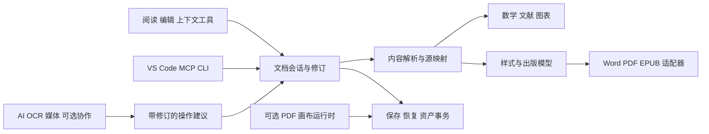

# ReadMD 用户体验与能力规划

ReadMD 的定位是以本地 Markdown 为中心的阅读、写作和内容生产工具。能力围绕用户正在处理的内容出现：选中公式才出现公式工具，选中表格才出现表格工具，导出时才选择论文或出版版式。默认仍是阅读页和一行编辑工具栏。版本号暂不指定，按可验收的能力包推进。

这是一个完整交付项目，公式与八类生产场景全部进入本轮最终验收；实施顺序不表示移到其他版本。版本号、GitHub 发布和宣传发布另行确定。逐需求状态记录在 `capability-upgrade-acceptance.json`，不能用模块、按钮或测试桩代替真实工作流。

## 当前基础与本轮改动

现有实现具备本地文件、标签页和会话恢复、Markdown 编辑与预览、任务和表格、双链和图谱、搜索、公式和图表显示、文献解析、转换、OCR、音视频转写、AI 对话和流式补全、多格式导出、演讲和局域网分享、插件、VS Code 扩展及 MCP。它们是扩展基础，不能据此宣称完整学术出版、多人协作或任意 PDF 原位编辑已完成。

已加入带修订检查的 Rust 内容事务、数学树及格式适配器、正文预览中的公式草稿与槽位编辑、矩阵行列和属性编辑，以及相邻隐藏元数据。目录中的 2,432 个字符、446 个 TeX 别名不是 Unicode 输入上限。DOCX 保留 OMML，PDF 使用矢量布局，EPUB 使用 MathML；这仍不能证明所有 OMML 属性的视觉语义已正确实现。

编辑预览中单击公式进入就地草稿，点选符号或槽位后修改，Tab 导航，Esc 取消，确认后形成一次正文撤销事务。双击仍兼容原有完整面板。Windows 原生文件保存、重开及三种导出已检查；本机 Word COM 启动报错，Word 修改后重开尚未验收。Schema 基线的 133 个条目含 9 个抽象类型，不能当成 133 个独立元素或 133 项已认证功能。

协作已采用 Yrs / Yjs 实现局域网和同内核自托管服务，包含持久化确认、角色权限、个人撤销、离线增量队列、评论、相对位置建议、附件和会话恢复。桌面主编辑器与网页来宾共用同步内核，Windows 已验证双向编辑、个人撤销、离线合并、后台标签页隔离、进程重启恢复和丢弃隔离。独立 HTTP 服务已通过 3／10／50 个 Yjs 文档的并发、重复投递、权限、个人撤销，以及乱序更新跨日志压缩和重启的检查；这不是 50 个原生窗口或长期测试，物理输入法及其他平台也仍待验收。见[协作操作与恢复](../guides/collaboration.md)。Hayagriva 已接入本地 BibTeX / CSL JSON、定位符和多条引用，正文、预览及非 LaTeX 导出共用只读出版投影。高级学术样式、交叉引用和实际排版引擎仍需继续实现与验收。

新增依赖使用精确版本与锁文件，构建离线；Yjs 在开启协作时按需加载。许可证与 80 个内置 CSL 样式的作者、来源、许可元数据随 `assets/licenses/` 交付。Rust 最低版本更正为 1.88，与当前锁定的 encoding_rs / ICU 依赖一致。

当前只有 Windows 原生环境，用户已确认没有其他测试机。macOS、Linux、国产 Linux 的原生运行证据待补；交叉编译不能替代原生验收。鸿蒙继续独立记录，不计入正式桌面平台认证。PDFium Windows 离线包和基础 PDF 页面对象编辑已走通原生保存、重开与恢复，完整 PDF 对象覆盖、八小时混合压力、专业轻绘画及其他引擎能力包仍未完成。

OpenAPI 3.0/3.1 JSON/YAML 已接入同一 Rust 服务：现有命令面板和 VS Code 命令生成差异，接受后一次撤销，Ctrl+S 才写文件；MCP 返回相同事务与源映射。更新只替换对应来源的生成区，保留外围笔记，拒绝源文件、正文或生成区手工修改后的过期覆盖。外部引用不联网抓取，保留并报告；这不是全部 OpenAPI 字段和跨文件引用的完整认证。详见 [操作与边界](../guides/openapi-documentation.md)。

## 统一的体验约定

| 情境 | 统一行为 |
| --- | --- |
| 打开文件 | 保留原文件与当前会话；转换预览不自动在原目录落地 |
| 开始编辑 | 打开不算修改，进入编辑不创建副本；只在内容变化后标记未保存 |
| 局部编辑 | 内容相关的悬浮操作或已有菜单；Esc 退出上下文，焦点返回内容 |
| 保存 | Ctrl+S 保存当前稿；原格式不可表达的变更先报告差异，再由用户选择输出；写入前修订检查、临时文件、原子替换 |
| 另存为 | 仅在明确指定时创建新文档，更新当前页归属；没有“最终版副本副本”自动堆积 |
| AI 写入 | 先审阅差异，再接受选区或全部；一个可撤销事务；拒绝过期结果覆盖新编辑 |
| 异常关闭 | 集中恢复区按文档身份与修订恢复；提供保存时间和来源；恢复不立刻覆盖磁盘原稿 |
| 撤销与历史 | 当前编辑使用事务撤销；已保存和跨会话操作使用受限历史；协作时仅撤销自己的操作 |
| 重任务 | 可取消、有进度、有明确失败原因；取消清理任务产物，不能把输入当临时文件删除 |
| 资源不足 | 队列和并发预算、流式处理、按页或按章加载；不因一个文件阻塞整个 UI |
| 高级能力 | 基础行为默认可用；高级版式和服务配置收在已有“高级”或上下文面板内 |
| 国际化 | 所有按钮、提示、错误、空态、进度、动态菜单和无障碍名称走 i18n；数学命令、文献键及用户内容不翻译 |

全局不新增“开发者/办公/科研”三套工作台。使用同一文档和同一命令体系，按文档内容和所选输出预设提供能力。首屏不摆放能力广告，不把内部任务编号、模型协议、AST 或插件开发参数放进普通用户操作区。

## 公式编辑的完整目标

### 从输入到修改的操作流程

1. 输入 `$`、`$$`、Alt+= 或现有“公式”命令，建立一个可撤销的公式范围。零基础用户可选择结构，熟练用户继续输入 LaTeX。
2. 选“分式”得到分子和分母槽位；点击槽位或 Tab/Shift+Tab 移动，直接输入普通文字、数字、希腊字母。空槽位只是编辑提示，不写入正文。
3. 选择渲染中的 `α`，在原位输入替换内容，或搜索“alpha / 阿尔法 / α / U+03B1”。选择 `≤` 或积分符号同理；视觉选择必须对应真实源范围，不能按相同文字做全局替换。
4. 选择结构的边缘才出现转换：上标变上下标、括号形状、积分上下限位置、矩阵增删行列、对齐点等。低频属性在该结构的“更多”中。
5. 源码和视觉编辑是同一个数学树的两个投影。无法结构化的宏保持源码并明确提示；不默默删除、拼凑或“修好”用户表达式。
6. 确认产生一个编辑事务，取消丢弃公式草稿；公式内部撤销与整篇文档撤销的边界明确。离开文档、改页或外部修改会使旧编辑目标失效。
7. 阅读态单击只选择或复制；进入编辑态再显示修改控件，避免阅读时误改。键盘、鼠标、触控与读屏必须都可完成。

### OMML 兼容的验收定义

OMML 的完整性必须同时检验四层：Unicode 字符与字形、19 类数学对象、对象和段落属性、与 Word 的无损往返。OfficeMath 基于 Unicode，符号不是一个固定有限的 OMML 枚举；“符号库很大”不等于全部 Office 排版行为兼容。[OfficeMath 模型说明](https://devblogs.microsoft.com/math-in-office/officemath/)、[Unicode 数学支持](https://www.unicode.org/reports/tr25/)。

从官方 Open XML SDK schema 生成了[完整命名空间清单](office-math-coverage.json)，包含 133 个 schema 条目（其中 9 个为抽象类型）、12 个枚举，以及子元素和属性名称。清单中的源码分支标记用于定位实现，不能充当功能验收；完整属性往返认证目前明确为未完成。WordprocessingML 的嵌入样式、修订与扩展命名空间需另设测试，不能被核心条目的计数掩盖。[官方 schema](https://github.com/dotnet/Open-XML-SDK/blob/main/data/schemas/schemas_openxmlformats_org_officeDocument_2006_math.json)。

| 对象 | OMML | 需要的编辑能力 | 当前边界 |
| --- | --- | --- | --- |
| 重音 | acc | 单/双点、帽、波浪、向量箭头；位置与拉伸 | 有常用命令；任意重音属性待验收 |
| 横线 | bar | 上/下横线、覆盖范围 | 上下横线已有投影；完整间距与 Word 往返待验收 |
| 排版盒 | box | 运算符模拟、断行行为、禁止断行、差分 | 尚缺完整输入/输出路径 |
| 带边框盒 | borderBox | 四边隐藏、水平/垂直/对角删除线 | 已有逐边与删除线的 MathML/PDF 投影；嵌套和 Word 往返待验收 |
| 定界符 | d | 任意两端、分隔符、伸缩与形状 | 基本左右括号已有；多段分隔与全属性待补 |
| 方程数组 | eqArr | 对齐点、行距、最大距离、对象距离 | 基本多行已有；对齐语义和属性待补 |
| 分式 | f | 横线、斜线、线性、无横线、字号 | 普通和二项式已有；全类型需统一 |
| 函数 | func | 函数名与参数分离、直立字形、间距 | 常见函数可显示；显式 func 语义待补 |
| 左上下标 | sPre | 前置上下标、同位素、张量 | 已有 MathML 空槽导入与合法 OMML 顺序；多脚本对投影诊断及 Word 往返待验收 |
| 下限 | limLow | 任意底式与下限，位置与间距 | 常见极限已有；任意底式和属性待补 |
| 矩阵 | m | 行列编辑、列对齐、占位、间距、基线 | 已有行列编辑、逐列对齐和基线投影；完整间距、环境及 Word 往返待验收 |
| 大运算符 | nary | 运算符、操作数、上下限、隐藏、伸缩 | 常见运算符已有；操作数树与全属性需补齐 |
| 占位 | phant | 显示/隐藏、零宽、零高、零深 | 已有显式开关的 MathML/PDF 投影；全部组合与 Word 往返待验收 |
| 根式 | rad | 根指数、被开方数、隐藏指数 | 平方根和 n 次根已有；显式属性值需补 |
| 分组字符 | groupChr | 上下大括号、标注、垂直对齐 | 已有上下分组字符投影；垂直对齐、任意字形及 Word 往返待验收 |
| 下标 | sSub | 底式与下标、嵌套、间距 | 基本写法已有 |
| 上下标 | sSubSup | 底式、上下标及对齐 | 已统一转换后的子对象顺序；组合属性与 Word 往返待验收 |
| 上标 | sSup | 底式与上标、嵌套、间距 | 基本写法已有 |
| 上限 | limUpp | 任意底式与上限 | 输出层有分支；输入到导出未闭环 |

共同属性也进入覆盖表：`rPr` 的字形/粗斜体/普通文本/断行/对齐点；`ctrlPr` 的 Word 样式和修订；`argPr` 的相对字号；`oMathParaPr` 的段落对齐；`mathPr` 的数学字体、二元运算断行、默认对齐、页边距、公式前后/内外间距、换行缩进、积分和其他大运算符上下限策略。每个开关要分别覆盖“缺省、显式开、显式关”；`val="0"` 不能因为元素存在就被解释为开启。

### 底层改造

现状是浏览器 MathJax 与 Rust LaTeX→OMML 两个解释器，支持范围可能不一致。保留 MathJax 作为排版器，但建立带源范围的 `MathDocument`：节点身份、结构类型、参数槽、属性、原始片段和诊断；由 Rust 提供 parse/validate/patch/serialize，前端只发送选择与编辑意图。LaTeX、UnicodeMath、MathML、OMML 是适配器，不另养四套文档状态。

关键接口目标为 `parse(source, dialect)`、`patch(nodeId, expectedRevision, operation)`、`serialize(target, lossPolicy)`。补丁限制在所属公式，计算新的源范围、光标与单次撤销信息。没有精确映射时拒绝猜改；源串、文档修订或模型版本不匹配时返回可恢复冲突。字体检查、未知宏、不可表达的 OMML 属性在导出预检中报告。

DOCX 目标是可继续编辑的原生 OMML；PDF 目标是矢量字形、可复制文本和字体嵌入；EPUB 使用可访问 MathML 与必要回退。不能拿公式截图冒充 Word 可编辑公式，也不能将“预览成功”冒充三个导出器均支持。

同一命令的字符身份也要比较，而非只看视觉相似：本轮校正了 `\cdot` 导出使用普通中点的问题，并对全部 446 个目录别名逐项断言其 OMML 输出保留与预览目录相同的字符。字符一致性仍不能替代上下限、间距和所有 OMML 属性的版式认证。

本轮进一步补齐了 MathML 前置／后置上下标、空槽和固定参数校验，修正 `sPre` 必须按 `sub、sup、e` 输出的顺序；矩阵逐列对齐和基线在 MathML 与 PDF 共用属性解释。字体包装命令现在解析内部公式，使用合法的 `scr`／`sty` 属性，避免旧输出中的无效粗体节点及字面反斜杠命令。分子、分母和脚本参数也已移除多余的 `m:e` 包装。离线预览的 `boldsymbol` 扩展按版本、提交和摘要锁定；源码中的数学属性默认折叠，不计入字数，保存和复制仍包含原始数据。矩阵显示真实行列数量，位置从 1 开始，禁用越界操作。多个张量脚本对仍明确报告投影诊断，完整 Word 往返与所有属性的视觉认证继续保留为剩余项。见[实际操作与边界](../guides/math-editing.md)。

测试集应由 Word 原生创建的 19 类对象、全部属性和值边界组成，再加嵌套组合、中文、RTL、Unicode 辅助平面、深层结构、恶意命令和损坏输入。每例比较“导入→局部修改→导出→Word 再开”的对象与属性，PDF/EPUB 检查缺字、布局和可访问文本。公式识别、手写识别、语音输入在结构编辑可靠后接入同一补丁接口；AI 只建议，不能决定数学正确性。

## 八类生产场景

### 程序员

真实任务是维护 README、API 文档、设计决策、故障复盘和代码示例。最重要的是文档与仓库同步、引用可定位、示例不失真、发布可复现。

| 工作流 | 默认交互 | 能力与验收 |
| --- | --- | --- |
| 克隆仓库后打开 README | 普通文件夹和目录，不要求建项目数据库 | 相对链接、大小写、锚点、图片、GFM 任务表格正确；跨平台路径测试 |
| 写设计文档 | 现有双链/标题补全、代码围栏、Mermaid、命令面板 | 补全不打断普通输入/IME/AI；图表语法错误定位源码 |
| 更新接口文档 | 选区插入/更新规范片段 | OpenAPI 等结构化资料用可选适配器提取；检测来源修订，生成差异，禁止重复追加 |
| 验证代码示例 | 代码块上下文“运行” | 明确运行环境、工作目录、超时、资源上限和取消；默认不执行文档脚本；危险命令不因 Markdown 打开而运行 |
| 提交和审阅 | 现有检查报告与差异 | 链接/图片/标题/公式诊断有源位置；CI 与桌面同一 Rust 服务；无未保存误报 |
| 编辑器联动 | VS Code 原生诊断、跳转、命令；MCP 调同一内核 | 不在 ReadMD 中再嵌 VS Code；MCP 读写有工作区约束、修订检查和恢复记录 |

已有链接/标题补全、分析、VS Code 与 MCP 是基础；接口文档生成和带资源隔离的示例执行需独立验收，不能靠按钮存在确认。

### 办公与协作

周报、会议纪要、项目表格、汇报文稿应由同一份内容生成。模板只带结构和样式，不自动发明 KPI、结论或签名。表格可粘贴 TSV/CSV，选择单元格才出现增删/对齐/排序；复杂电子表格计算继续使用真实表格引擎的可选适配器，不伪装成完整 Excel。

多人协作需要共享文档、参与者权限、在线光标、评论/建议、个人撤销、离线队列、重连合并、版本快照和冲突解释。现有局域网二维码分享是阅读共享，不能标为协同编辑。

实现使用 Yrs 0.28.0 / Yjs 13.6.33 的同版协议。服务端管理鉴权、持久化、权限和修订；客户端以增量队列保存离线修改。建议保存服务端生成的相对位置与原选区内容，不相关编辑可以合并，选区发生重叠修改则留待冲突审阅。依赖已锁定，构建不访问网络。[Yjs 同步模型](https://docs.yjs.dev/)、[离线持久化](https://docs.yjs.dev/getting-started/allowing-offline-editing)。

最低验收：3/10/50 人并发、同字符同时插删、两人同时改公式/表格、离线重连、服务重启、成员降权/退出、附件缺失、只读泄漏、个人撤销不回滚他人内容。协作附件去重并受权限保护；分享按钮内显示会话状态，不新增常驻团队管理栏。

#### 自托管、备份与升级

`readmd-collaboration` 与桌面局域网主持调用同一 Rust 服务。发布包需要同时保留 `assets/collaboration`、`assets/css/tokens.css`、`assets/vendor/yjs.bundle.js`、`assets/i18n` 和许可证文件。离线构建命令：

```powershell
cargo build --offline --locked --manifest-path rust/Cargo.toml -p readmd-kernel --bin readmd-collaboration
```

服务读取 `READMD_COLLAB_ADMIN_TOKEN` 环境变量（至少 32 字符）；不要把管理凭证写入启动参数、日志或公开页面。示例部署目录：

```powershell
readmd-collaboration --data-dir D:\ReadMD-Service\data --assets D:\ReadMD-Service\assets --listen 127.0.0.1:27941 --public-origin https://docs.example.org
```

公网部署由 HTTPS 反向代理转发到该回环地址，保留原始 `Host`；例如 Caddy 的 `reverse_proxy 127.0.0.1:27941`。创建会话使用 `POST /sessions` 和管理 Bearer 凭证；参加者使用会话凭证，不能用参加者凭证创建会话。接口只提供会话资源，不能访问桌面文件 API。读写权限、附件和成员撤销在服务端执行。

同一协作数据库只允许运行一个可写服务，重复拥有者以 `collaboration_busy` 拒绝打开。系统持有稳定的空锁文件，正常关闭或进程终止后释放租约；不要手工删除锁文件来启动第二个服务。旧版本不识别新租约，升级必须先停止旧进程，再启动新版本；当前不支持多个可写服务共用一个资料目录。限定规格与实测见[协作安全规格](v006-batch3-collaboration-safety-spec.md)。

备份使用一致的 SQLite 快照，包含已经确认但尚在 WAL 中的操作，可在服务运行时执行：

```powershell
readmd-collaboration --data-dir D:\ReadMD-Service\data --backup D:\ReadMD-Backups\before-upgrade.sqlite
readmd-collaboration --data-dir D:\ReadMD-Service\restored --restore D:\ReadMD-Backups\before-upgrade.sqlite
```

`--backup` 使用独立只读 SQLite 连接，不取得可写服务的租约；保持现有服务运行即可在线备份。

备份和恢复都拒绝覆盖已有文件。恢复会检查完整性与数据库结构；始终恢复到新目录，确认正文、评论、附件及成员权限后再切换服务。不能仅复制正在运行的 `collaboration.sqlite` 而漏掉 WAL。备份包含正文、附件及凭证摘要，按文档资料保管。升级前生成备份，停止旧进程，再成套替换二进制与资源；回退时使用旧程序和对应的备份恢复目录，不让旧程序直接改写新结构数据库。

`ui-tests/collaboration-selfhost.cjs` 使用真实二进制检查会话编辑、运行中备份、服务重启、恢复和覆盖拒绝。原始证据与当前代码摘要在验收账本单独记录；单次通过不表示协作全场景已完成。

### 科研与学术

目标工作流是“素材和文献→有出处的论证→图表公式→期刊/学校版式→Word/PDF→导师修订”。正文与版式分离，一份 Markdown 能切换论文、报告、投稿草稿；切换预设不污染正文。

| 能力 | 用户操作与输出要求 |
| --- | --- |
| 学术信息 | front matter 或已有文档属性中编辑题目、摘要、作者、机构、通讯作者、关键词、基金、ORCID；缺项只提示，不编造 |
| 文献 | 本地 BibTeX/CSL JSON/受控文献库；引用建议显示作者年份，支持定位符与多条引用；样式使用经过验证的 CSL 管线；字段不完整能追溯 |
| 交叉引用 | 标题、公式、图、表拥有稳定标识；增删后编号更新，正文引用可跳转；DOCX 用可更新字段和书签，PDF 用真实内部链接 |
| 论文版式 | 预设统一定义纸张、单双栏、页边距/装订线、标题级别、段前后/行距、字体字号、首行/悬挂缩进、列表、脚注/尾注、题注、页眉页脚、页码、分页与孤行控制 |
| Word 参数可编辑 | 先选择预设，再在原有导出高级设置展开对应参数；保存为用户预设；生成真实 Word 样式、节属性和编号，避免每段硬编码 |
| LaTeX 模板 | 模板参数与正文分离，模板/引擎版本锁定、离线编译、沙箱、禁默认 shell-escape；编译日志定位源码；缺宏包返回具体缺项 |
| PDF | 统一分页模型；字体嵌入、公式矢量、可复制文本、书签、交叉链接；可选 PDF/A 与可访问标准必须经验证器认证后才显示支持 |
| 修订 | 导师改回 Word 时显示导入差异、样式冲突及未知对象，选择接受；不能直接整篇覆盖原 Markdown |

当前已接入真实 Hayagriva CSL 引用、定位符和参考文献；阅读、编辑预览、DOCX/PDF/EPUB 共用处理，不改写正文中的引用键。原生 DOCX 与矢量 PDF 是基础，不等同期刊规范或 PDF/A/UA 认证。Typst 学术适配器仍待实现，不把换排版引擎等同于上述功能已经实现。[Typst 引用](https://typst.app/docs/reference/model/bibliography/)、[PDF 标准导出](https://typst.app/docs/reference/pdf/)。

#### 当前离线 LaTeX 编译路径

在“导出 → PDF → 定制排版 → 排版引擎”选择 XeLaTeX 或 pdfLaTeX，默认仍使用内置 Rust 排版。外部引擎只在选择后运行；使用本机已安装的引擎，不下载宏包或字体。LaTeX 模式显示它实际使用的文类、字号、纸张、页边距和 CTeX 参数，并隐藏尚不能投影的原生样式控件。MCP `readmd_export_document.options` 使用相同参数与 Rust 服务。

正文先经过相同的 CSL 处理，再生成临时 TeX，避免运行两套文献处理器、重复参考文献。临时源码、辅助文件和图片保留在集中临时目录；成功后仅原子保存 PDF。预览直接使用编译产物，正式导出复用该产物；正文、参数、文献或图片变动会使缓存失效。大型资源集超过缓存预算时重新生成，不复用过期产物。

编译限制为同时 2 个任务、总计 120 秒、最多 4 次排版来稳定交叉引用，输出及日志有容量上限。预览变更或关闭时向后端取消任务；Windows 已实测正在运行的 XeLaTeX/pdfLaTeX 取消后停止，目标文件不落地。错误定位标明**生成的 TeX 源码行号**，不伪称原 Markdown 行号。实现禁用 shell escape 和自动生成缺失格式/字体，MiKTeX 禁止自动安装。[Web2C 参数说明](https://tug.org/texinfohtml/web2c.html)。

这条路径已在本机通过英文、中文、公式、表格、CSL、引用稳定、错误定位和取消实测。任意第三方 LaTeX 模板导入、完整参数投影、操作系统级沙箱以及锁定的离线引擎包尚未交付；当前 TeX 进程限制不等同完整沙箱。相关剩余项继续记录在 R030。

预设首批应是通用中文课程论文、通用研究论文、双栏投稿草稿、学位论文骨架和办公技术报告；期刊/学校名称只能在拿到其规范并验证后使用。参数表达能力优先于堆积“看似专业”的预设名字。

### 转换与原位处理

转换结果要同时报告内容保留、结构保留、版式损失与原稿去向。批量转换复用既有工作台：去重、逐项状态、取消、重试失败项、统一输出规则、完成后打开结果。保留原文，按需保存新 MD；恢复区集中存储，不在每个目录生成隐藏资产和无限副本。

PDF 必须拆成三条真实路径：

- 阅读/批注：高亮、手写批注、印章、页旋转/排序、表单、书签，保存为仍可阅读的 PDF。
- 原位修改：在 PDF 页面坐标中编辑文本/图像，检查嵌入字体、字形子集、重排范围、透明度和资源引用；不能表达时明确限制。保留未改页面、链接和附件；数字签名失效必须在保存前说明。
- 转为 Markdown 重排：适合内容再加工，允许版式变化，但绝不能叫“原样 PDF 编辑”。

已接入经许可证审查并锁定摘要的 PDFium 7881 独立工作进程和 Windows x64 离线包。页面原生文字、图片、文本批注、基础表单、旋转和删除页可修改，草稿、撤销和集中历史不在源目录产生副本。Windows 原生测试验证保存重开、未改页像素一致、中文字体、加密与分项权限、锁文件重试、外部修改拒绝、重启恢复和取消不提交。

这仍不是完整 PDF 编辑认证：嵌套 XObject、所有表单类型、有效数字签名样本、扫描区域校订、手写和安全涂黑尚待补齐；不得以覆盖矩形冒充安全涂黑。密码只经匿名管道送入工作进程，不写入草稿、日志或命令行。详见 [离线包、保存与恢复](../guides/pdf-workspace.md)。

音视频使用起止时间和轨道作为输入，精确提取选段，不转写整段后让用户自己找。结果保留时间戳、说话人、语言、置信度和跳回媒体的链接；可选择逐字稿/纪要/字幕。长媒体分段、断点续作、去重缓存；模型不存在、网络中断、无声音、双声道和视频变帧率必须能解释。现有转写入口和服务只证明基础路径，需要再补选段与精确寻址。

### AI 赋能

统一“选内容→提意图→看差异→接受”的路径，复用已有 AI 面板、选区工具和灰字补全。对话模型、补全模型、OCR/多模态和本地模型按任务路由；优先使用用户当前连接中速度适合的模型，不能把内容悄悄发给别的服务。

补全要有防抖、取消、过期结果丢弃、缓存、短上下文与逐步显示；Tab 接受，Esc 取消，IME 期间不抢焦点。长文润色按段落与章节计划执行，保留引用、数字、公式、代码和链接；数学与事实检查结果作为待审建议。

深度对接的优先级是公开 API、兼容协议、本地服务、文件/选区交接和 MCP。对网页或桌面 AI 软件的操作只走其官方授权接口，不能以抓 Cookie、模拟网页私有接口或读取账户目录作为常规集成。不同模型的鉴权、分页模型列表、流式错误、限流、代理和离线错误都有统一反馈。

实测必须覆盖真实模型成功请求、401/403、429、超时、半途断流、空答、无支持模型、模型下线、切标签、编辑竞争和取消后无写入；测试材料使用专用副本，报告不含密钥。AI 的费用、可用性、联网边界可在当前连接设置中查看，不增加另一套“AI 控制中心”。

### 学习与教学

作业流程是原稿→选定排版要求→AI 提出修改→学生确认→检查公式/引用/分页→导出 PDF。默认保护解题过程和原始答案；AI 不把错题“美化”成正确答案，也不虚构引用。

教师从同一讲义生成演讲、练习和答案版本；答案块可在导出时按明确规则隐藏。批注与反馈保留来源、位置和时间，不直接覆盖学生原稿。OCR 手写作业保留原图与低置信度定位，数学手写走数学树，不把识别出的图片冒充可编辑公式。

绘图与思维笔记先复用 Mermaid、SVG 和图谱：选图进入上下文编辑器，源码和图形修改共用对象；手绘板阶段支持压力、倾斜、橡皮、撤销、缩放与 SVG/PNG 输出。笔迹存在集中资产区，保存文档时才按输出策略打包。

教学验收材料要包含三角函数、分段函数、表格、中文长题、图注、跨页推导与参考答案；A4 打印、无网络、投影字号、色弱/高对比、键盘和数位板分别测试。

### 长篇写作与出版

小说/专著用普通 Markdown 章节和显式目录清单组织；在已有侧栏按章浏览、拖动顺序、全书搜索和统计。不要求把作品迁入私有数据库；人物与设定可复用笔记双链，不增加常驻“人物/世界观/素材库”三套面板。

编辑一章不加载全书进编辑器；跨章重命名、引用、题注和图片由工作区服务维护。全书导出前预检缺章、重复 ID、失链、图片、字体、版权页、目录、封面和语言元数据。EPUB 应具有导航、章节顺序、可重排文本和正确媒体类型；用 EPUBCheck 和多个阅读器验收，不能以 ZIP 能解压证明电子书合格。[EPUB 3.3](https://www.w3.org/TR/epub-33/)。

手稿流程是扫描原件→逐页 OCR→低置信度比对→AI 错别字/一致性建议→作者确认→结构化章节→出版排版。保留原图坐标与版本映射；多人称、方言、虚构名词不能被自动纠正。AI 编辑报告区分事实矛盾、语言建议、风格偏移与排版检查，不代作者擅改情节。

压力材料包括百万字、千章、万处链接、数千图片、跨章移动中断与导出取消。读取按章，索引增量更新；资产内容寻址和去重，恢复历史按配额回收，当前稿及仍引用资产不被自动清理。

### 泛用与创意

沉浸式阅读继续提供主题、字体、页宽、目录、分页/滚动、阅读位置和无干扰模式；记事本流程保持 Ctrl+N、输入、保存和退出恢复。功能升级不能增加打开短笔记的等待、背景联网或隐藏磁盘开销。

数位板接入属于可选画布能力，首先定位为文档批注、示意图和草图：低延迟笔迹、压力、笔/橡皮、选区移动、少量图层和导出。它不能在保持轻量的前提下直接承诺完整 Photoshop/SAI2 的色彩管理、滤镜、笔刷引擎、PS 文件兼容与大型栅格合成。需要这些时可通过系统默认应用编辑资产，回到 ReadMD 自动刷新并提供恢复。

创意内容仍围绕文档：图文教程、交互式代码示例、讲义、流程图、思维笔记、离线作品集和电子书。交互脚本在受限执行上下文中运行，权限来自明确操作，而不是 Markdown 文本中夹带的指令。

## 高内聚和低耦合的实现方式

不要先拆出十几个新 crate。先在 Rust 内核建立明确模块边界，只有独立依赖、运行时、生命周期或稳定复用要求出现时再拆包。



| 边界 | 职责 | 不应承担 |
| --- | --- | --- |
| 文档会话 | 内容身份、修订、选区、撤销事务、恢复 | 具体模型 API、PDF 页绘制 |
| 内容服务 | Markdown AST、源映射、标题/链接/数学/引用的稳定身份 | 任意文件写入与 UI 状态 |
| 版式服务 | 可继承的样式、节、分页约束、题注、交叉引用 | 根据按钮位置拼导出规则 |
| 格式适配器 | 输入结构、损失报告、输出和验证 | 默默用截图替换不可表达结构 |
| 资产服务 | 临时资产、内容散列、引用关系、保存时提交、受限回收 | 在用户目录随意写缓存 |
| 任务服务 | 取消、进度、并发预算、断点、错误类别 | 直接覆盖正在编辑的文档 |
| AI 服务 | 连接、模型能力、流、建议、成本和隐私边界 | 将迟到结果当最终用户内容 |
| 扩展接口 | 能力声明、稳定参数、版本、权限和资源限制 | 让插件绕过修订/恢复规则 |

对外共享 DTO 和稳定错误码，前端按错误码翻译；错误日志只含必要定位信息。命令、HTTP、原生桥、MCP 和 VS Code 调用相同内容服务，避免“界面能用、MCP 不同规则”或“浏览器成功、安装版桥接失效”。

普通 Markdown 仍是可独立阅读的正文。明确的版式预设和模板可以是导出配置；项目确实需要多章顺序、画布或未知 Office 对象时才使用显式清单/受管资产。未知对象保存原件与损失报告，不伪装成无损 Markdown。遵循 CommonMark/GFM，并把扩展语法和可移植性标明。[CommonMark](https://spec.commonmark.org/0.31.2/)。

## 实施顺序与发布门槛

| 能力包 | 交付物 | 放行条件 |
| --- | --- | --- |
| 公式体验与安全 | 数学树、共享符号库、槽位与原位编辑、结构与属性操作 | 精确定位、取消/撤销/恢复、IME、无横向溢出、无过期覆盖；19 类对象及所有属性差异清零后才能宣称完整 OMML |
| 学术与出版 | 统一版式 schema、交叉引用、CSL、可编辑 Word 样式、PDF 预检、可选离线模板编译 | 同一论文 Word/PDF 一致性、参数确实生效、原稿保护、缺字/失链/引用错误可定位 |
| 转换与媒体 | 损失报告、输出事务、媒体选段和时间戳、批次断点 | 每个格式真实文件成功/失败/取消、原件不变、无目录污染、超大文件资源受限 |
| 审阅与协作 | Yrs / Yjs 同步、审阅建议、持久化确认与恢复 | 并发/断网/重连/权限/个人撤销矩阵通过；分享阅读与协作编辑明确区分 |
| PDF 与手绘 | 可选独立运行时、批注到原位修改、文档画布 | 页面对象保留、字体限制、签名和涂黑验证；数位板实机延迟、压力、取消和保存恢复 |
| 内容生态 | 长篇管理、可选 AI/服务适配器、MCP 能力完善 | 跨章/资产/外部修改/大量文件实测；扩展与主应用相同安全和保存规则 |

不把第三、四、五包的按钮提前放进界面。不具备后端与验收条件的功能只在此规划里出现，不以“即将支持”的失效按钮占位。引入协作、PDF 编辑、CSL 或编译引擎之前，要解决依赖、许可证、体积和平台运行条件；本轮允许经审查和锁定的成熟组件，构建仍全部离线，大型引擎通过按需能力包交付。

## 全流程验收方法

每个功能至少包含成功、取消、错误、连续操作、外部变化和恢复六种流程。实测以安装/打包后的 Windows 原生 WebView 为主，浏览器测试补充布局和交互；有条件后再增加 macOS、Linux、鸿蒙真机。窄屏网页通过不能替代原生平台认证。

性能目标先作为待测预算：普通输入事件不做磁盘扫描或网络等待；超过 100ms 的本地操作应有状态；大型工作区索引、导出、OCR 和媒体在有界任务中处理；以百万字、万链接、千公式和长媒体记录 CPU、峰值内存、首帧、交互 P95 和取消耗时。必须公布测试机器、材料、并发与冷/热启动条件，不用一个平均耗时声称所有场景快速。

国际化检查要覆盖字符串键、动态内容和实际布局。主语言逐项人工核对，其他语言使用项目明确的回退策略并标注，不能将“46 个文件都有键”解释成 46 种语言均已完成自然翻译。日期、数字、读屏顺序和长文案也进入用例。

每次能力包完成后录制专用合成资料的最短真实操作：操作前后有可理解的内容变化，4K 素材、无系统文件夹/私人路径/通知、无录制编号。AI 等待加速需明示。宣传只引用已通过验收的能力；实时协作、原位 PDF 和全 OMML 在完成对应门槛前不能写成现成功能。

当前实现和测试入口见 `assets/js/editor/formula-studio.js`、`assets/math-catalog.json`、`rust/readmd-kernel/src/math_catalog.rs`、`ui-tests/formula-studio.spec.js`、`tools/test/formula-source.test.mjs`。后续每包沿用现有功能清单记录真实按钮、前端流程、Rust 后端与验证结果，版本号在可发布范围确定后再定。
